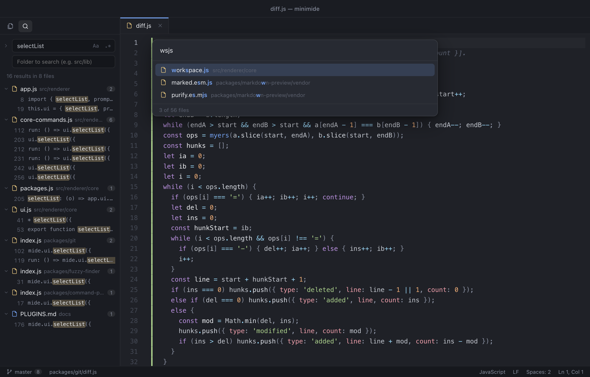

# Minimide

A small, beautiful, hackable editor, in the spirit of Atom.



- **Simple by default.** A file tree, tabs, a command palette and a fuzzy finder. Nothing
  else until you ask for it.
- **Fast and modern.** Built on CodeMirror 6 with lazy-loaded syntax highlighting for
  100+ languages.
- **Hackable to the core.** Every feature is a package that uses the same public API
  yours will. Packages hot-reload as you edit them.

## Getting started

```bash
npm install
npm start                  # or: npm start -- /path/to/project
npm run dev                # same, with DevTools open
```

## Everyday keys

| Key | Action |
| --- | --- |
| `⌘⇧P` | Command palette: every action lives here |
| `⌘P` | Find file (`name:42` jumps to line 42) |
| `⌘E` | Find among open tabs |
| `⌘⇧F` / `⌘⇧H` | Find / replace in project |
| `⌘F` / `⌘D` / `⌘⇧L` | Find in file / add next match / select all matches |
| `⌘B` | Toggle sidebar |
| ``Ctrl-` `` | Toggle bottom panel |
| `⌘⇧R` | Run a shell command in the project |
| `⌘\` | Split right |
| `⌘K ⌘→` / `⌘K ⌘←` | Focus next / previous pane |
| `Ctrl-G` | Go to line |
| `⌘,` | Settings |
| `Ctrl-⇧M` | Markdown preview |

On Linux and Windows, read `⌘` as `Ctrl`. Every binding can be changed in `keymap.json`.

## What's included

| Package | What it does |
| --- | --- |
| `tree-view` | File tree with preview tabs, keyboard navigation (`a`, `A`, `m`, `d`, `F2`, `Delete`), drag-to-move and git colors |
| `command-palette` | Fuzzy-search every command, most recently used first |
| `fuzzy-finder` | Open files and tabs by fuzzy name |
| `find-in-project` | Regex / case-sensitive search and replace across the project |
| `git` | Branch switcher, tree status, change markers in the editor gutter |
| `run-panel` | Run builds, tests and scripts; ANSI colors; click `file:line` to jump there |
| `markdown-preview` | Live, sanitized preview in a split pane |
| `settings-view` | Settings, themes, packages and keybindings, generated from schemas |
| `status-bar` | Cursor, selection, language, indentation, line endings |
| `nightfall`, `daylight`, `fjord` | Themes (`Theme: Select Theme…` previews them live) |

Power-user extras: multi-cursor and rectangular selection, chord keybindings, split panes
that stay in sync, session restore, auto-save, Zen mode, line sort / unique / join /
case transforms, trim-whitespace-on-save, reopen closed tab, live reload of every config file.


## Make it yours

Everything personal lives in `~/.minimide/`:

| File | Purpose |
| --- | --- |
| `config.json` | Settings (comments allowed). Also editable in the Settings UI. |
| `keymap.json` | Your keybindings. Wins over every package. |
| `styles.css` | Your CSS, loaded last. Every color is a variable. |
| `init.js` | JavaScript run at startup with the full package API. |
| `packages/` | Your packages. **Packages: Create New Package…** scaffolds one. |

The full API is in [docs/PLUGINS.md](docs/PLUGINS.md) (or **Help → Plugin API Docs** in the app).

## Architecture

```
src/main/main.js        Electron main: windows, mide:// protocol, fs / process / dialog IPC
src/preload/preload.cjs The only bridge to Node (contextIsolation + sandbox)
src/renderer/
  app.js                Boot, session, welcome screen, user files
  core/                 commands, keymap, config, workspace (panes/tabs), editor (CodeMirror),
                        ui (select lists, docks, status bar), packages (loader + scoped API)
  styles/base.css       Layout and components; reads only CSS variables
packages/               Built-in packages, loaded exactly like user packages
```

The renderer has no Node access. Packages are loaded as ES modules from
`mide://pkg/<name>/`. Each package gets its own API object, which records everything the
package registers, so it can be disabled, enabled or reloaded at runtime without restarting.

## Roadmap ideas

LSP client package · real PTY terminal (node-pty) · minimap · packaged builds with
electron-builder · package installation from git URLs.
