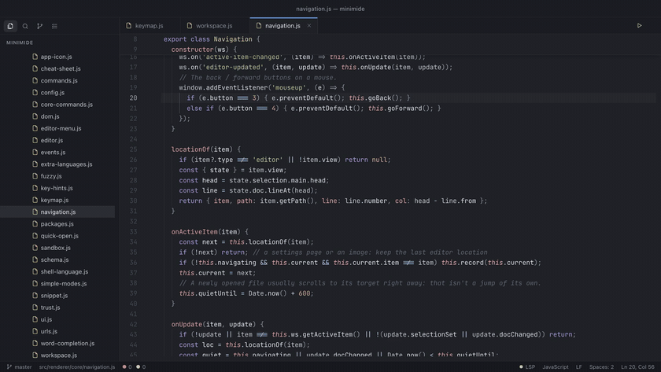

<div align="center">


# Minimide

**The editor you can read in an afternoon.**

A small, beautiful code editor in the spirit of Atom. Every feature is a package
you can change while it runs.

[](LICENSE)


[](https://github.com/mikemich/minimide/releases/latest)
[](https://mikemich.github.io/minimide/try/)

<a href="docs/media/shortcuts-demo.mp4"></a>

*Hold ⌘ to see every shortcut, peek at a definition, jump there and back. **[Try it in your browser →](https://mikemich.github.io/minimide/try/)***

The browser demo can open any public GitHub repo, with edits kept in the tab: `https://mikemich.github.io/minimide/try/?repo=owner/name` (add `&ref=branch-or-tag` or `&path=src/file.js` to pick a version or a file to open). Or run **Open a GitHub Repo…** from the command box.

</div>

Minimide's core is about 5,000 lines of plain JavaScript, and the whole editor, all 42
built-in packages included, is about 10,000. The file tree, git panel, terminal, language
servers, Vim mode and every theme are packages built on the same API you get, and they
reload the moment you save. Make it yours.

```bash
curl -fsSL https://mikemich.github.io/minimide/install.sh | sh
```

<a href="docs/media/theme-reel.mp4"></a>

*19 themes and 27 fonts, built in. Even the Dock icon follows your theme.*

## Why

Remember when your editor felt like *yours*? Atom made hacking your tools feel fun:
open a file, change how the editor works, see it happen. GitHub shut Atom down in
2022, and editors have since grown into platforms nobody fully understands. You can
configure them, but you can't really change them.

Minimide picks up Atom's idea, small enough to own:

- **Readable.** The core is about 5,000 lines; the rest is packages. No framework and no
  build magic. You can read every line that runs.
- **Everything is a package.** The tree view, search, git, the language-server client,
  the settings screen and every theme use the same public API yours will. There's no
  private back door.
- **Change it while it runs.** Save a package and it reloads instantly. `init.js`,
  `styles.css`, `keymap.json` and `config.json` in `~/.minimide` do the same.
- **Safe to share.** Atom's packages could do anything, and opening a repo was blind trust.
  Minimide's installed packages run in a sandbox: no access to your files, programs or the
  internet unless you approve the permissions they ask for. Folders you haven't trusted open
  in Restricted Mode, with git and language servers off. See [SECURITY.md](SECURITY.md).
- **Simple by default.** A file tree, tabs, a command palette and a fuzzy finder, built
  on CodeMirror 6 with syntax highlighting for 160+ languages and file types (Makefiles,
  Terraform, nftables, logs, CSV…). Power tools such as LSP,
  split panes, multi-cursor and project-wide replace are there when you reach for them.

## Getting started

**macOS or Linux**, in one line (downloads the latest release and checks its SHA-256):

```bash
curl -fsSL https://mikemich.github.io/minimide/install.sh | sh
```

**Or download** from the [Releases page](https://github.com/mikemich/minimide/releases/latest):
`-arm64.dmg` for Apple Silicon, plain `.dmg` for Intel, `Setup-…-x64.exe` for Windows,
`.AppImage` for Linux. The builds aren't signed yet, so a downloaded app needs one extra
click the first time: **System Settings → Privacy & Security → Open Anyway** on a Mac, or
**More info → Run anyway** in Windows SmartScreen. The install script avoids this.

Minimide checks for updates once a day and can update itself (**Check for Updates…**
in the app menu). Turn that off with `core.checkForUpdates`.

Or run from source (Node 20+):

```bash
npm install
npm start                  # or: npm start -- /path/to/project
npm run dev                # same, with DevTools open
```

### Building the app

```bash
npm run dist:mac           # Minimide.app, .dmg and .zip (Apple Silicon + Intel) in release/
npm run dist:dir           # just the unpacked app, for a quick local test
npm run dist               # installers for the current platform
```

Local Mac builds are ad-hoc signed: they run on your machine, but other people's Macs
will block them until they allow the app in **System Settings → Privacy & Security**.
For a download anyone can open, you need a *Developer ID Application* certificate (Apple
Developer Program) and notarization. Add them as secrets and the release workflow in
`.github/workflows/release.yml` does the rest. Push a tag like `v0.1.0` to build
macOS, Windows and Linux installers into a draft GitHub release. Regenerate the icon
with `npm run icon`.

## Your first package, in one minute

Run **Packages: Create New Package…** from the command palette (`⌘⇧P`), or drop
this into `~/.minimide/packages/hello/index.js`:

```js
export function activate(mide) {
  mide.commands.add('hello:greet', 'Say Hello', () => mide.notify.success('Hello from my editor!'));
  mide.statusBar.addItem({ element: mide.ui.h('span', '👋 mine'), align: 'right' });
}
```

with a one-line `package.json`: `{ "name": "hello", "main": "index.js" }`.

Save it and the status bar changes immediately. Edit it, save again, and it reloads.
That's the whole loop. The full API is in [docs/PLUGINS.md](docs/PLUGINS.md).

## Everyday keys

Forgot one? Hold `⌘` for a moment and every shortcut on screen gets a label: tabs, sidebar, status bar, and what you can do at the cursor. `⌘K ⌘H` opens a one-page cheat sheet, and right-clicking in the editor shows the code actions with their keys. The first time you start Minimide, a small card shows these three tricks with a "Try it" button each; **Show Welcome Tips** in the command box brings it back.

| Key | Action |
| --- | --- |
| `⌘⇧P` | Command palette: every action lives here, and plain words work ("remove line" finds Delete Line) |
| `⌘P` | One box for everything: files (`name:42` jumps to a line), or type `>` commands, `@` symbols in the file, `#` symbols in the project, `:` a line, `?` help |
| `⌘E` | Find among open tabs |
| `⌘⇧F` / `⌘⇧H` | Find / replace in project |
| `⌘F` / `⌘D` / `⌘⇧L` | Find in file / add next match / select all matches |
| `⌘B` | Toggle sidebar |
| ``Ctrl-` `` | Toggle terminal (``Ctrl-⇧-` `` for a new one) |
| `⌘⇧5` | Split the terminal (up to four side by side) |
| `F5` / `⌘⇧R` | Run the current file in its own task tab (`⇧F5` stops, `⌘⌥R` runs it again) |
| `⌘⇧B` | Run a task: npm scripts, Makefile targets, Cargo, Go, or any command |
| `⌥F5` | Debug the current Python or JavaScript file (while debugging: `F5` continues, `⇧F5` stops, `⌘⇧F5` restarts) |
| `F9` / `F10` / `F11` / `⇧F11` | Toggle breakpoint / step over / step into / step out |
| `⌘⇧↩` | Send the selection (or current line) to the terminal |
| `⌘\` / `⌘K ⌘\` | Split right / down (drag the dividers to resize) |
| `⌘K ⌘→` / `⌘K ⌘←` | Focus next / previous pane |
| `⌘K ⌘↑` / `⌘K ⌘↓` | Focus the pane above / below |
| `Ctrl-G` | Go to line |
| `⌘,` | Settings |
| `⌘K ⌘S` | Search all keybindings (`⌘K ⌘⇧S` opens them in Settings) |
| `Ctrl-⇧M` | Markdown preview |
| `F12` / `⌘`-click | Go to definition (LSP) |
| `⌥F12` | Peek definition: read it inline without leaving the file (LSP) |
| `⌃-` / `⌃⇧-` | Go back / forward after a jump (`Alt-←` / `Alt-→` on Linux and Windows; mouse back buttons work too) |
| `⇧F12` | Find references (LSP) |
| `F2` | Rename symbol (LSP) |
| `⌘.` | Code actions / quick fix (LSP) |
| `⌘R` / `⌥⌘P` | Go to symbol in file / in the whole project (LSP) |
| `⌘/` | Toggle comment |
| `⌘I` / `⌘K ⌘I` / `⌥\` | AI: chat about your code / edit the selection (with a preview) / suggest code at the cursor |
| `⇧⌥F` | Format document (LSP) |
| `F8` / `⇧F8` | Next / previous problem |
| `⌘K ⌘P` | Problems panel |
| `⌃⇧G` | Source control panel (`⌘K ⌘D` diffs the current file) |
| `log` + `Tab` | Expand a snippet (`Snippets: Insert Snippet…` lists them all) |
| `ul>li*3` + `Tab` | Expand an Emmet abbreviation in HTML, JSX, Vue and CSS files |

On Linux and Windows, read `⌘` as `Ctrl`. Every binding can be changed in `keymap.json`.

## What's included

| Package | What it does |
| --- | --- |
| `tree-view` | File tree with preview tabs, keyboard navigation (`a`, `A`, `m`, `d`, `F2`, `Delete`), drag-to-move and git colors |
| `command-palette` | Fuzzy-search every command, most recently used first |
| `fuzzy-finder` | Open files and tabs by fuzzy name |
| `find-in-project` | Regex / case-sensitive search and replace across the project |
| `ai` | Chat about your code, edit a selection with a side-by-side preview, fix the problem on a line, explain code and get suggestions at the cursor, with Claude (your own API key, stored encrypted and only ever used by the main process) or a local Ollama model. Nothing is sent until you ask, and it asks first |
| `lsp` | Language servers: completions (with auto-import), diagnostics, hover with go-to links, signature help, go to / peek definition, references, rename, quick fixes with a 💡, formatting, file and project symbols, Problems panel |
| `git` | Branch switcher, tree status, change markers in the editor gutter |
| `source-control` | Git panel (`⌃⇧G`): stage, unstage, discard, commit, amend, push, pull, and side-by-side or inline diffs |
| `terminal` | A real terminal (xterm.js + node-pty) in tabs, with side-by-side splits; click `file:line` in output to jump there |
| `remote-ssh` | **Remote: Open Folder over SSH…** edits a folder on another machine through a local copy, kept in sync with your own `ssh` and `rsync` (uploads on save, asks when both copies changed). macOS and Linux |
| `runner` | Run the current file with `F5` (Python, JS/TS, Go, Rust, C/C++, Java, Ruby, shell and more) or a project task with `⌘⇧B`; each task gets its own terminal tab and long ones notify you when they finish out of sight (`runner.notifyAfter`) |
| `debugger` | Breakpoints (click the gutter or `F9`, optionally with a condition), stepping, call stack, variables, watch expressions and a Debug Console, for Python (needs `debugpy`) and JavaScript (Node.js 22+) |
| `markdown-preview` | Live, sanitized preview in a split pane that scrolls with the editor (and the other way round). In the editor itself, pasting an image into a Markdown file saves it to `images/` and inserts the link, and Markdown and plain text get spell check with suggestions in the right-click menu (turn it off with `editor.spellcheck`) |
| `settings-view` | Settings, themes, packages and keybindings, generated from schemas |
| `status-bar` | Cursor, selection, language, indentation, line endings, and word count with reading time for Markdown and text files |
| `editor-guides` | Scope-aware indent guides |
| `image-viewer` | Opens PNG, JPG, GIF, WebP, SVG and more in a tab with zoom (`⌘+` / `⌘-` / pinch) |
| `sticky-scroll` | Pins the headers of the function, class or block you're in to the top of the editor |
| `snippets` | 170+ built-in snippets in 25 languages, offered as you type or expanded with Tab, plus your own in VS Code format. Autocomplete also suggests words already in the file |
| `emmet` | `div#app`, `ul>li.item*3` or `m10` plus Tab in HTML, JSX, Vue and CSS, plus Wrap with Abbreviation and Balance Tag commands |
| `vscode-import` | **Import Settings from VS Code…** brings over your settings, keybindings, snippets and color theme from VS Code, Cursor, VSCodium or VS Code Insiders, after a preview with a checkbox for each thing |
| `settings-sync` | **Sync: Upload / Download Settings** keeps your config, keymap, styles, init script and snippets the same on every computer, in a private GitHub gist |
| `color-preview` | Inline swatches for `#hex`, `rgb()` and `hsl()`; click a hex swatch to pick a new color |
| `git-blame` | Who changed the current line, and when, shown at its end (like GitLens) |
| `todos` | Highlights TODO / FIXME / HACK / NOTE in comments, plus a sidebar listing them all (`⌘K ⌘T`) |
| `code-image` | **Copy as Image** (right-click menu or `>`) draws the selection, or the file, as a PNG in your theme and font: a rounded window with the file name on a soft accent backdrop. **Save as Image…** writes it to a file. Optional line numbers |
| `vim-mode` | Full Vim emulation with `:w`, `:q`, `:wq`, `gt`, `jj` escape and relative numbers. *Off by default* |
| `minimap` | A zoomed-out map of the file (`⌘K ⌘M`). *Off by default* |
| `focus-mode` | Typewriter scrolling and paragraph dimming for writing. *Off by default* |
| `fonts` | 27 bundled open-source fonts for code and UI (JetBrains Mono, Fira Code, Cascadia Code, Geist, Iosevka, Monaspace, Inter…) with live previews in **Settings → Fonts**. Each font keeps its own license (SIL OFL or Ubuntu Font License) in `packages/fonts/licenses` |
| `nightfall`, `midnight`, `fjord`, `daylight`, `dune`, `ember`, `grove`, `rosewood`, `nocturne`, `cocoa`, `harvest`, `metro`, `volcano`, `abyss`, `contrast`, `paper`, `glacier`, `blossom`, `solstice` | 19 themes, from true-black and high-contrast to paper and blossom (`Theme: Select Theme…` previews them live). Pick any accent color on top in **Settings → Themes** |

Packages marked *off by default* are installed but switched off to keep the default
editor simple. Turn them on in **Settings → Packages**.

Power-user extras: multi-cursor and rectangular selection, chord keybindings, split panes
that stay in sync, session restore, auto-save, Zen mode, line sort / unique / join /
case transforms, trim-whitespace-on-save, reopen closed tab, live reload of every config file.


## Language servers

The `lsp` package starts a server the first time you open a matching file. It only
needs the server to be on your `PATH`; if it's missing, Minimide shows the install command.

| Server | Languages | Install |
| --- | --- | --- |
| `typescript-language-server` | TS / JS / JSX / TSX | `npm i -g typescript@5 typescript-language-server` (TypeScript 7 doesn't work with it yet) |
| `pyright-langserver` (or `pylsp`) | Python | `npm i -g pyright` |
| `rust-analyzer` | Rust | `rustup component add rust-analyzer` |
| `gopls` | Go | `go install golang.org/x/tools/gopls@latest` |
| `clangd` | C / C++ / Obj-C | `xcode-select --install` |
| `vscode-{css,html,json}-language-server` | CSS / HTML / JSON | `npm i -g vscode-langservers-extracted` |
| plus | Bash, YAML, Lua, Ruby, PHP, Zig, Svelte | see `packages/lsp/servers.js` |

Add or override servers in `config.json`:

```jsonc
"lsp": {
  "formatOnSave": true,
  "servers": {
    "elixir": { "command": ["elixir-ls"], "extensions": ["ex", "exs"] },
    "python": { "command": ["pylsp"], "settings": { "pylsp": { "plugins": { "ruff": { "enabled": true } } } } },
    "typescript": { "initializationOptions": { "tsserver": { "path": "/path/to/typescript/lib" } } }
  }
}
```

Server status and restarts live in the status bar; server output is in the
**Language Servers** panel (turn on `lsp.trace` to log every message).

## Make it yours

Everything personal lives in `~/.minimide/`:

| File | Purpose |
| --- | --- |
| `config.json` | Settings (comments allowed). Also editable in the Settings UI. |
| `keymap.json` | Your keybindings. Wins over every package. |
| `styles.css` | Your CSS, loaded last. Every color is a variable. |
| `init.js` | JavaScript run at startup with the full package API. |
| `snippets.json` | Your snippets in VS Code's format. Or drop VS Code snippet files into `snippets/`. |
| `packages/` | Your packages. **Packages: Create New Package…** scaffolds one. |
| `installed.json` | Packages you installed, and the permissions you gave them. |

### Coming from VS Code

Run **Import Settings from VS Code…** (or press the button on the Settings page). Minimide finds
the user folder of VS Code, VS Code Insiders, Cursor or VSCodium and shows a preview: one
checkbox for each setting, for the color theme, for each keybinding and for each snippet file.
Nothing changes until you press **Import**.

- **Settings** with a Minimide equivalent (font, tab size, word wrap, auto save, minimap, sticky scroll, …) are written to `config.json`. The ones without are listed under "Not imported".
- **Color theme**: a built-in theme is chosen when one is close (Dark+ becomes Nightfall); otherwise the theme from your installed extensions is converted into a new package, with faint text made easier to read.
- **Keybindings** are added to the end of `keymap.json` in a marked block, so your own lines and comments stay. Commands with no equivalent are skipped, and a key you already bind yourself is left unticked.
- **Snippets** are copied into `snippets/`. A file that would replace one of yours is saved beside it as `<name>.vscode.code-snippets`.

Minimide only reads `settings.json`, `keybindings.json`, `snippets/` and the theme files that
installed extensions declare. It never writes to VS Code's folder.

### Sync your settings

**Sync: Set Up…** connects Minimide to a private GitHub gist in your own account. If the GitHub
CLI (`gh`) is logged in it offers to use that; otherwise paste a token that has only the `gist`
scope. The token is kept encrypted by your operating system and handled by the main process,
so packages and the page never see it, and it is never written to `config.json` or `state.json`.

- **Sync: Upload Settings** sends `config.json`, `keymap.json`, `styles.css`, `init.js`, `snippets.json`, your `snippets/` files and the list of GitHub packages you installed. The gist is private, but anyone with its link can read it, so keep secrets out of these files.
- **Sync: Download Settings** opens a preview with a diff for each file that differs and a checkbox to keep or skip it. Nothing changes until you press **Apply**, files that are replaced are first copied to `~/.minimide/backups/<time>/`, and `init.js` is never ticked for you because it is code. Packages you don't have yet are listed, and you install them one by one through the usual dialog.
- **Sync: Sign Out** forgets the token on this computer. The gist stays on GitHub.

### Sharing packages

Install other people's packages from **Settings → Packages → Discover**, or with
**Packages: Install Package…** and a GitHub `owner/repo`. To publish yours, push it to GitHub
and add the `minimide-package` topic.

Installed packages run **sandboxed**: in a separate worker with no access to your files,
programs or the internet. A package that needs more asks for specific permissions
(`project-files`, `network`, …), and you see them before you install it.

Folders get the same care: the first time you open one, Minimide asks whether you trust it.
Until you do, git and language servers stay off for it, because both can run code that comes
with a repository (a command in its git settings, a TypeScript copy in `node_modules`). A package that
asks for full access gets a clear warning. Packages you write yourself are trusted like
the rest of your code. See [Sharing packages, and the sandbox](docs/PLUGINS.md#sharing-packages-and-the-sandbox).

The full API is in [docs/PLUGINS.md](docs/PLUGINS.md) (or **Help → Plugin API Docs** in the app).

## Convert a VS Code theme

`scripts/vscode-theme.mjs` turns any VS Code color theme file into a Minimide theme package.
It accepts JSON with comments and trailing commas (JSONC), which is the format VS Code themes
use in the wild.

```bash
node scripts/vscode-theme.mjs path/to/your-theme.json
# writes packages/theme-<slug>/package.json and theme.css
```

To write into a different directory:

```bash
node scripts/vscode-theme.mjs path/to/your-theme.json --out /tmp/my-themes
```

The script maps VS Code `colors` keys (`editor.background`, `sideBar.background`,
`terminal.ansi*`, …) to Minimide's CSS variables, and maps `tokenColors` scopes
(`comment`, `string`, `keyword`, `entity.name.function`, …) to the `.tok-*` syntax
classes. Colors that aren't present in the VS Code theme are derived from `bg` and `fg`
so every variable is always defined. The `type` field (`"dark"` / `"light"`) sets
`color-scheme` automatically.

You can also import the converter directly:

```js
import { parseJsonc, convertTheme } from './scripts/vscode-theme.mjs';
const vsTheme = parseJsonc(await fs.readFile('my-theme.json', 'utf-8'));
const { slug, packageJson, themeCss } = convertTheme(vsTheme);
```

## Architecture

```
src/main/main.js        Electron main: windows, mide:// protocol, fs / process / dialog IPC
src/preload/preload.cjs The only bridge to Node (contextIsolation + sandbox)
src/renderer/
  app.js                Boot, session, welcome screen, user files
  core/                 commands, keymap, config, workspace (panes/tabs), editor (CodeMirror),
                        ui (select lists, docks, status bar), packages (loader + scoped API)
  styles/base.css       Layout and components; reads only CSS variables
packages/               Built-in packages, loaded exactly like user packages
```

The renderer has no Node access. Packages are loaded as ES modules from
`mide://pkg/<name>/`. Each package gets its own API object, which records everything the
package registers, so it can be disabled, enabled or reloaded at runtime without restarting.

## Roadmap ideas

Debug adapter (DAP) package · signed and notarized builds · a sandboxed API for panels.

## License

MIT. See [LICENSE](LICENSE).
